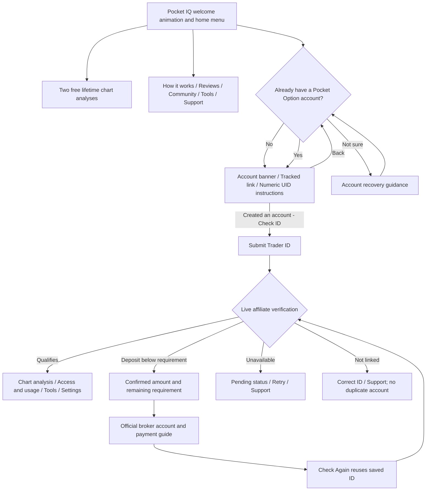

# Go Plus Telegram chat flow

This updates the existing aiogram bot. There is no Mini App or second polling service.

Home has Try 2 Free Analyses; Set Up My Account (or Continue Setup / Open My Dashboard);
How It Works; Reviews; Support; Community; Tools & FAQ; Language.
Both account answers open the same registration card with three full-width buttons:
Create New Account (green), I Created an Account — Check ID (blue), and Back (red).
The caption and first button use the same tracked referral URL; users can submit a numeric
UID directly in chat or open the ID prompt. UID guidance and Support remain on that prompt.
Already verified or referral-confirmed accounts continue from their saved access state.
Community contains the existing Telegram channel, YouTube, and reviews destinations.
Tools contains the money-management workbook, asset guide, FAQs, and risk/referral information.
Settings contains language, shared notification preferences, and privacy information.
The dashboard links to the asset catalogue and persisted daily allowance.
Signals now use Market → Category → Asset → Expiration (M1–M10) → Chart and BUY/SELL analysis.
See [MARKET_SIGNALS.md](MARKET_SIGNALS.md) for catalogue coverage and live-data eligibility.
Premium compares allowances, explains the qualifying deposit requirement, and checks the saved linked ID.

The welcome uses the approved Pocket IQ 3D artwork: `assets/home_banner_loop.mp4`
is a silent 1280×720, six-second H.264 animation, sent through Telegram `sendAnimation`
for GIF-style playback. `assets/home_banner.png` is its matching still fallback.
Both keep the caption and buttons on one message. Content hashes invalidate older
Telegram media IDs automatically; animation IDs remain separate from video IDs.

On a private-chat `/start`, the first welcome message is pinned silently. Its ID
and pin timestamp are saved separately from disposable menu messages, so menu
navigation, signal cleanup, redeploys, and `/devstart` preserve the anchor.
Later starts do not create extra pins or undo the user's decision to unpin/hide
it. A failed pin never blocks the menu; an unfinished pin is retried on the next
start, and a deleted pending message can be replaced with the fresh welcome.

The persistent card's caption is the owner's **POCKET IQ — START HERE** copy.
Welcome and Start Here share the reference's six-row layout: one green Get Bot
Access button; blue Guide / Test Signals; red Review / Support; blue YouTube /
Channel; a full-width blue Money Management Sheet; and full-width red Change
Language. Review, Support, YouTube, and Channel open the configured official
links directly, with the existing help fallback if a URL is unavailable.
Verified accounts see My Dashboard in the top row and Analyse My Chart beside
Guide. Setup still resumes saved progress through Get Bot Access. The Start Here
caption refers to this button by its displayed name.
The approved GIF, caption and buttons stay on one card. Telegram controls the
actual font size and button height; the bot chooses row layout and native colors.

Startup edits saved cards in place, with pagination and rate-limit backoff;
it does not send replacement messages or re-pin dismissed cards. Every menu
render checks for changes, including immediately after successful verification.
A persisted content hash avoids redundant Telegram edits across restarts.
The hash includes the custom emoji theme so new owner-supplied IDs refresh
existing pins. Pin, camera, rocket, home, support bubble, community, tools,
and unlock icons use the supplied custom IDs in captions and native buttons.
Account, Premium crown, trophy, key, lock, referral link, account-ID location,
new-account, and payment icons use the owner's second batch. The account-ID
location pin is separate from the welcome pin; no new search-icon ID was supplied.
Success, error, question, information, warning, blocked, waiting, retry, pause,
and settings icons use the owner's third batch. The supplied warning triangle
covers both exclamation and warning glyphs; text/emoji presentation variants
of information, pause, and settings share the same custom artwork.
Chart-analysis headings, market analysis, momentum, screenshot examples,
pending results, currency pairs, and timers use the owner's fourth batch.
Image, pending, and timer glyphs include both presentation variants.
Navigation, notification preferences, shuffle, fire, direction markers, attention,
gift, money, and admin-test icons use the owner's fifth batch. Back arrows use
the blue arrow; tutorials and forward navigation use the green play icon, while
YouTube-labelled buttons retain their branded icon. Gallery arrows gain Back/Next
labels with native icons. The supplied warning ID already matches the theme;
the OTC diamond still awaits a custom ID.
All twelve language buttons use the owner's custom flag IDs as native icons.
The selected language keeps its flag and displays a text checkmark beside its
name; the existing two-column layout, language callbacks, and saved choice remain.
Text-only fallback welcomes are updated with the text-edit API. Deleted or
blocked chats are left alone; failed edits never block access to normal menus.

## State and validation

`db.SCHEMA` adds setup progress, account path, eligibility timestamp, and the last access-check outcome.
All migrations use `ADD COLUMN IF NOT EXISTS`; existing verification, language, attribution, and quotas remain.
Returning setup resumes from persisted account state. Both account answers open registration directly;
there is no separate introduction or age-confirmation screen. Older callbacks and saved stages resume
the current registration or UID step. The historical eligibility timestamp is retained without
automatically recording a declaration for users in the simplified flow.
The optional background retry checks unverified users who have submitted a UID.
The existing panel campaign check and qualifying-deposit totals decide access.
Missing, non-finite, or invalid deposit data produces pending status, never a confirmed zero or access grant.
Typed ID retries remain single-flight and throttled. Premium stays tied to the verified account and real deposit check.
`VERIFY_MODE=test` can bypass Standard verification only for configured admins and labels that screen explicitly.
The old `CHART_UI_TEST_COPY` flag no longer enables unsupported accuracy claims.

## Configuration

Existing live credentials and `REF_LINK`, attribution parameters, campaign, and thresholds are reused.
No new required environment variables or runtime dependencies are introduced.
Optional public URL overrides: `REVIEWS_URL`, `COMMUNITY_URL`, `SETUP_GUIDE_URL`, and `BROKER_ACCOUNT_URL`.
Support accepts either an @handle or full Telegram URL. Missing/placeholder URLs lead to a support fallback.
The workbook still uses the existing stored Telegram file ID and `/setgift` command.

Official reference pages: [broker terms](https://pocketoption.com/en/public-offer/) and
[payment policy](https://pocketoption.com/en/payment-policy/), checked 2026-10-23.

## Language scope

Existing 12-language translations and saved choices remain. New setup/help copy is English in this release,
with an explicit notice in the selected language. It is deliberately not partially translated through old phrases.
Full translations of the new screens remain a separate content task.

## Release and rollback

The existing deployment uses `Procfile` (`web: python bot.py`) and the repository's `main` branch.
After release, `/health` returns `flow_version: trust-first-v1`. This verifies the HTTP deployment,
not a real trading account or a live chart inference. Do not run a second bot poller to test production.
For rollback, redeploy the previous commit; the added nullable/defaulted columns can remain.

## Validation

Run `python scripts/check_offline.py` with the existing requirements installed.
It isolates each test process and excludes tests requiring live AI or a PostgreSQL test database.
Navigation tests cover direct setup, legacy callbacks, new/existing accounts, resume after restart, saved-ID deposit retries,
unavailable/wrong-link states, notification preferences, every help screen, and Premium checks.
Existing suites cover quota refunds, duplicate uploads, cancellation, panel single-flight checks,
media fallbacks, localization, analytics, reminders, and broadcasts.
